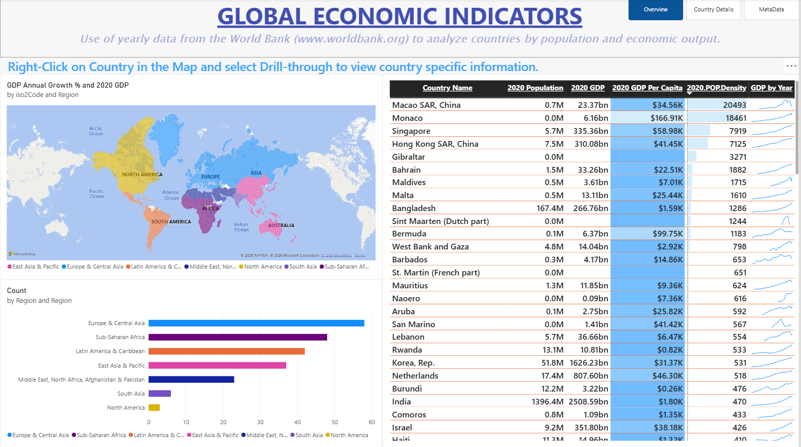
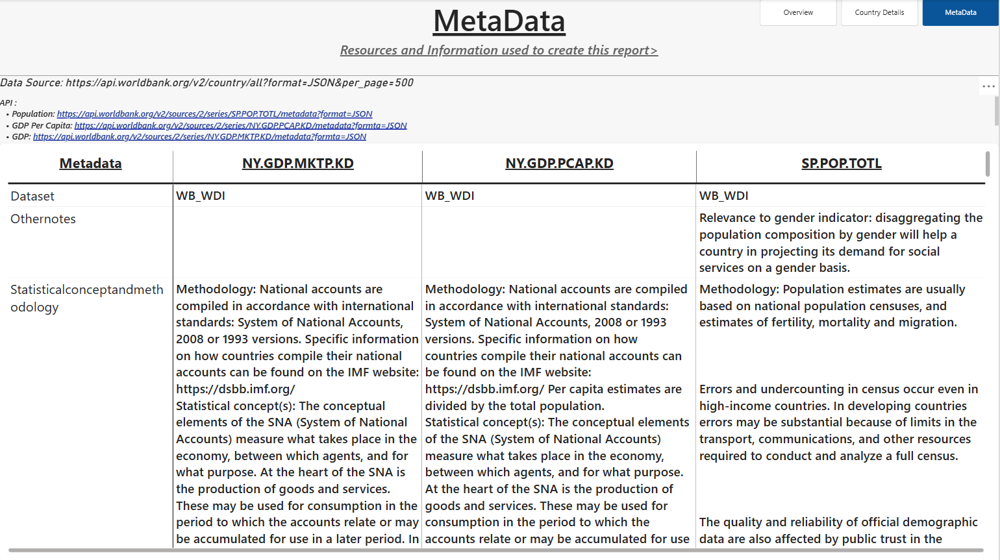

# Global GDP & Population Analytics | Power BI

A Power BI portfolio report for exploring country-level GDP and population indicators through maps, charts, and detailed views.

## Dashboard pages

1. **Overview** — country comparison table, filled map, and bar chart.
2. **Country Details** — summary cards, a detailed table, and a combined line/column chart for closer exploration.
3. **MetaData** — supporting information and a pivot-style table.

## Skills demonstrated

- Power BI report design and data visualization
- Geographic comparisons using a filled map
- Tabular analysis and KPI cards
- Combined line and column chart
- Multi-page report navigation

## Dashboard gallery

Click any screenshot to view it at full size.

### 1. Overview

### 2. Country Details

### 3. MetaData

## Repository contents

- `Global-GDP-Population-Analytics.pbix` — Power BI Desktop report
- `screenshots/` — screenshots of the Overview, Country Details, and MetaData pages

## Notes

The project is provided as a portfolio demonstration. Please verify the source data, coverage periods, and measures before using results for external research or decision-making.
